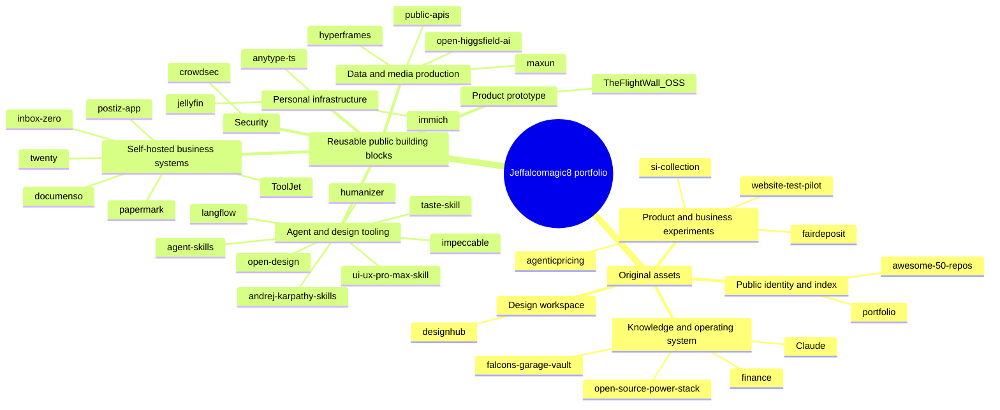
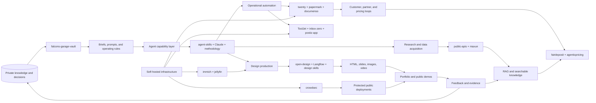

# GitHub Portfolio Inventory

**Account:** [jeffalcomagic8](https://github.com/jeffalcomagic8)  
**Snapshot date:** 2026-08-23  
**Collection method:** Authenticated GitHub CLI API query across all pages, with `owner`, `collaborator`, and `organization_member` affiliation.  
**Scope:** 34 repositories visible to the authenticated account: 25 public and 9 private; 11 original repositories and 23 forks.

This is an inventory of the GitHub account, not a second copy of the 50-project external catalog in [50-github-repos.csv](50-github-repos.csv). The account contains six especially clear workstreams: AI agent and design tooling, self-hosted business software, personal knowledge and operating systems, product experiments, learning/reference assets, and security/infrastructure.

## Executive Readout

| Portfolio signal | Count | Interpretation |
|---|---:|---|
| Total repositories | 34 | A broad exploration portfolio with a small original core |
| Public repositories | 25 | Primarily forks and public skills/tooling intended for reuse or sharing |
| Private repositories | 9 | Personal knowledge, finance, design, pricing, and product-development space |
| Original repositories | 11 | The clearest expression of your own operating system and product direction |
| Forks | 23 | A working library of upstream building blocks, not yet a set of differentiated products |
| AI/agent/design related | 12 | The strongest recurring theme across original work and selected forks |
| Self-hosted business/product systems | 9 | A practical stack for CRM, documents, media, communications, and automation |

## Full Inventory

The **role** column is the recommended primary classification. A repository can support several workflows, but one primary role keeps the portfolio navigable.

| Repository | Access | Relationship | Primary role | Recommended use | Portfolio action |
|---|---|---|---|---|---|
| [awesome-50-repos](https://github.com/jeffalcomagic8/awesome-50-repos) | Public | Original | Reference index | Maintain a curated map of external tools and learning resources | Keep as the public index; add tags and review dates |
| [TheFlightWall_OSS](https://github.com/jeffalcomagic8/TheFlightWall_OSS) | Public | Fork | Product experiment: live data display | Turn flight data into an ambient display or local dashboard | Prototype candidate; document hardware and data dependencies |
| [hyperframes](https://github.com/jeffalcomagic8/hyperframes) | Public | Fork | Agent media/rendering | Generate HTML-based video and visual artifacts from agent workflows | Explore as a media output adapter |
| [open-higgsfield-ai](https://github.com/jeffalcomagic8/open-higgsfield-ai) | Public | Fork | Generative media studio | Run image and cinema-generation workflows locally or privately | Evaluate for creative production; track model licenses |
| [public-apis](https://github.com/jeffalcomagic8/public-apis) | Public | Fork | Integration catalog | Find external data sources for prototypes and automations | Keep as discovery infrastructure; do not treat entries as guarantees |
| [ToolJet](https://github.com/jeffalcomagic8/ToolJet) | Public | Fork | Internal tools platform | Build CRUD apps, dashboards, workflows, and lightweight agent interfaces | Candidate application shell for operations |
| [agent-skills](https://github.com/jeffalcomagic8/agent-skills) | Public | Fork | Agent capability library | Package repeatable engineering behaviors for coding agents | Promote to a governed skill registry |
| [falcons-garage-vault](https://github.com/jeffalcomagic8/falcons-garage-vault) | Private | Original | Personal knowledge base | Store durable notes, decisions, research, and operating context | Treat as the private system of record |
| [portfolio](https://github.com/jeffalcomagic8/https-jeffalcomagic8.github.io-portfolio-) | Public | Original | Public identity and showcase | Present selected work, skills, and experiments | Make this the front door; link to maintained projects only |
| [open-design](https://github.com/jeffalcomagic8/open-design) | Public | Fork | AI design production | Produce prototypes, dashboards, slides, images, and exportable artifacts | High-priority convergence point for design workflows |
| [langflow](https://github.com/jeffalcomagic8/langflow) | Public | Fork | Visual agent orchestration | Compose and test LLM workflows with a visual interface | Use for fast workflow experiments and demos |
| [maxun](https://github.com/jeffalcomagic8/maxun) | Public | Fork | Web data acquisition | Crawl and extract structured data without hand-building scrapers | Pair with RAG and research workflows |
| [fairdeposit](https://github.com/jeffalcomagic8/fairdeposit) | Private | Original | Product experiment: transaction/service concept | Develop and validate a focused product hypothesis | Keep private; define one measurable customer workflow |
| [website-test-pilot](https://github.com/jeffalcomagic8/website-test-pilot) | Private | Original | Web experimentation | Test website concepts, prompts, and interaction patterns | Use as a disposable lab; promote only validated work |
| [si-collection](https://github.com/jeffalcomagic8/si-collection) | Private | Original | Software collection | Organize or prototype a TypeScript-based set of experiments | Add a README describing its boundary and graduation path |
| [impeccable](https://github.com/jeffalcomagic8/impeccable) | Public | Fork | AI design quality system | Improve generated interfaces through a consistent design language | Pair with `taste-skill` and `ui-ux-pro-max-skill` |
| [taste-skill](https://github.com/jeffalcomagic8/taste-skill) | Public | Fork | Agent design judgment | Reduce generic output and encode stronger aesthetic decisions | Use as a review gate for generated UI |
| [ui-ux-pro-max-skill](https://github.com/jeffalcomagic8/ui-ux-pro-max-skill) | Public | Fork | UI/UX agent skill | Give agents structured design intelligence across platforms | Use during brief-to-prototype execution |
| [postiz-app](https://github.com/jeffalcomagic8/postiz-app) | Public | Fork | Content operations | Schedule and distribute social content with agent assistance | Candidate outbound channel for launches and experiments |
| [crowdsec](https://github.com/jeffalcomagic8/crowdsec) | Public | Fork | Security and threat intelligence | Protect self-hosted services using collaborative detection | Baseline security layer for public deployments |
| [papermark](https://github.com/jeffalcomagic8/papermark) | Public | Fork | Document distribution and analytics | Share proposals, decks, and documents with engagement signals | Candidate for sales, research, and partnership workflows |
| [inbox-zero](https://github.com/jeffalcomagic8/inbox-zero) | Public | Fork | Personal communications automation | Triage, search, and reduce email backlog | Use as a daily operations surface |
| [immich](https://github.com/jeffalcomagic8/immich) | Public | Fork | Private media archive | Store and search personal photos and video under your control | Use as the media source for creative workflows |
| [anytype-ts](https://github.com/jeffalcomagic8/anytype-ts) | Public | Fork | Local-first knowledge workspace | Organize structured personal information across devices | Compare with the private vault; avoid duplicate systems of record |
| [jellyfin](https://github.com/jeffalcomagic8/jellyfin) | Public | Fork | Private media delivery | Serve owned media to personal devices | Infrastructure utility, not a primary product direction |
| [twenty](https://github.com/jeffalcomagic8/twenty) | Public | Fork | CRM and relationship operations | Track contacts, deals, and relationships in a self-hosted system | Candidate system for partnership and product pipelines |
| [documenso](https://github.com/jeffalcomagic8/documenso) | Public | Fork | Agreements and signatures | Execute documents and approvals without a hosted lock-in | Add to a business-operations stack |
| [open-source-power-stack](https://github.com/jeffalcomagic8/open-source-power-stack) | Private | Original | Stack architecture and research | Decide which open-source services become part of the operating stack | Maintain as the decision log and reference architecture |
| [agenticpricing](https://github.com/jeffalcomagic8/agenticpricing) | Private | Original | Commercial strategy | Explore pricing models for agent-enabled products | Connect product experiments to explicit revenue hypotheses |
| [Claude](https://github.com/jeffalcomagic8/Claude) | Private | Original | AI workspace and notes | Hold Claude-related skills, prompts, or working material | Consolidate overlapping agent guidance with `agent-skills` |
| [andrej-karpathy-skills](https://github.com/jeffalcomagic8/andrej-karpathy-skills) | Public | Fork | Coding-agent methodology | Apply practical LLM coding lessons to agent behavior | Use as a reference input, not as a product by itself |
| [designhub](https://github.com/jeffalcomagic8/designhub) | Private | Original | Design workspace | Collect and develop design artifacts and experiments | Candidate private staging area for `open-design` outputs |
| [finance](https://github.com/jeffalcomagic8/finance) | Private | Original | Personal finance operations | Track financial information and decisions privately | Keep isolated; never expose through public demos or agents |
| [humanizer](https://github.com/jeffalcomagic8/humanizer) | Public | Fork | Editorial quality skill | Remove formulaic AI writing patterns from drafts | Add as the final editorial pass in publishing workflows |

## Taxonomy

## Ontology and Workflow Relationships

## Recommended Grouping and Leverage

| Group | System of record | What to build around it | Best workflows |
|---|---|---|---|
| Personal operating system | `falcons-garage-vault` | Decisions, research, prompts, and reusable context | Daily planning, research capture, project retrospectives |
| Agent production system | `agent-skills` plus `Claude` | A versioned library of skills, checks, and agent procedures | Coding, design critique, document transformation, publishing |
| Design-to-artifact pipeline | `open-design`, `langflow`, `impeccable`, `taste-skill`, `ui-ux-pro-max-skill` | Brief -> prototype -> critique -> export | Websites, dashboards, slides, product discovery |
| Research-to-knowledge pipeline | `maxun`, `public-apis`, and a RAG layer | Source collection -> normalization -> retrieval -> decision | Market research, competitive scans, technical investigation |
| Operations stack | `ToolJet`, `twenty`, `papermark`, `documenso`, `inbox-zero`, `postiz-app` | Contacts -> documents -> approvals -> distribution | Sales, partnerships, launch operations, communications |
| Private media and infrastructure | `immich`, `jellyfin`, `crowdsec` | Secure storage and delivery for owned media | Asset library, demos, personal archive, protected services |
| Product learning loop | `website-test-pilot`, `fairdeposit`, `agenticpricing`, `TheFlightWall_OSS` | Hypothesis -> prototype -> evidence -> pricing decision | Validate ideas before promoting them to public products |
| Public presence | `portfolio` and `awesome-50-repos` | Curated proof of work and useful references | Hiring, partnerships, credibility, discoverability |

## Near-Term Portfolio Decisions

1. **Consolidate agent guidance.** Make `agent-skills` the canonical public skill library; keep `Claude` private for experiments and move mature material outward deliberately.
2. **Choose one knowledge system.** Use `falcons-garage-vault` as the private source of truth and treat `anytype-ts` as an evaluated client or alternative, not a competing archive.
3. **Create one reference deployment.** Combine `ToolJet`, `twenty`, `papermark`, `documenso`, `inbox-zero`, and `crowdsec` into a documented self-hosted operations blueprint.
4. **Turn design forks into a pipeline.** Define `open-design` as the production surface, with the three design skills as inputs and `humanizer` as the editorial release check.
5. **Separate exploration from commitment.** Keep forks as upstream dependencies until you add a clear local change, maintainer notes, tests, or an integration; promote only the projects that produce repeatable value.
6. **Connect experiments to evidence.** Give each private product repository a one-page hypothesis, target user, next test, success metric, and promotion or archive decision.

## Data Quality Notes

- Counts and visibility are accurate for the authenticated GitHub API response at snapshot time.
- GitHub reports 25 public repositories on the account profile; the detailed query returned 34 account-visible repositories because it also included 9 private repositories.
- Repository descriptions, names, fork status, languages, and timestamps came from GitHub metadata. The recommended roles and workflows are an analytical classification based on those metadata and the repository names/descriptions, not a claim about implementation completeness.
- The local 50-repo catalog includes external upstream projects and is intentionally separate from this account inventory.